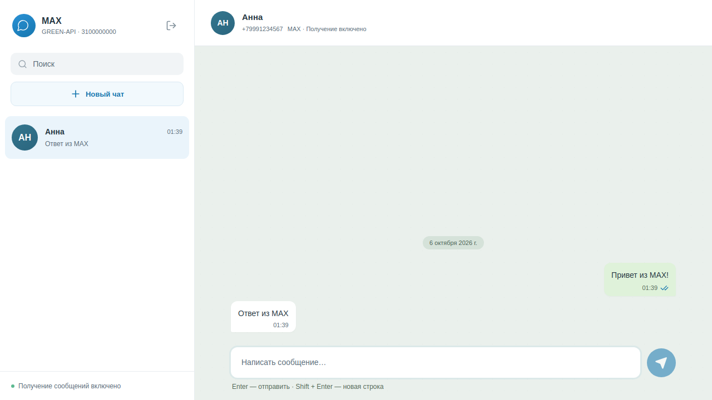

# green-api-testovoe

Тестовое задание «Фронтенд разработчик React»: простой интерфейс отправки и получения **текстовых сообщений в Telegram, MAX и WhatsApp** через **GREEN-API**. Telegram выбран по умолчанию как разрешенная в задании альтернатива MAX; другие мессенджеры подключаются через адаптеры. Интерфейс использует двухколоночную структуру веб-чата: список разговоров, сообщения и поле ввода. На телефоне список и разговор открываются отдельно. Настройки и ошибки остаются видимыми в обоих состояниях; получение можно возобновить прямо из открытого чата.

## Локальный запуск

Нужен Node.js **22.12+** (либо 24+) и npm.

```bash
cd green-api-testovoe
npm ci
npm run dev
```

Откройте <http://127.0.0.1:5173>. Переменные окружения не нужны: учетные данные вводятся в интерфейсе.

## Подготовка GREEN-API

1. Выберите мессенджер на экране входа и создайте **инстанс соответствующего мессенджера** в [личном кабинете GREEN-API](https://console.green-api.com/) и авторизуйте свой аккаунт. Для Telegram это интеграция пользовательского аккаунта через GREEN-API, токен Telegram-бота не подходит. При переключении мессенджера поля учетных данных очищаются; неверный тип инстанса блокирует вход.
2. Скопируйте `idInstance`, `apiTokenInstance` и `apiUrl` из кабинета. Введите ID и токен на экране входа. Адрес API автоматически определяется по первым четырем цифрам ID; если адрес в кабинете отличается, укажите его в разделе «Адрес сервера API».
3. В настройках инстанса включите **«Получать уведомления о входящих сообщениях и файлах»** (`incomingWebhook: yes`). Оставьте **Webhook URL пустым**, чтобы получать уведомления через HTTP API. Приложение проверяет настройки при входе и показывает подсказки; настройки аккаунта автоматически не изменяет.
4. Для отображения доставки и прочтения включите уведомления о статусах исходящих сообщений (`outgoingWebhook: yes`). Для синхронизации текстов, отправленных с телефона и через API, включите соответствующие уведомления (`outgoingMessageWebhook`, `outgoingAPIMessageWebhook`).
5. Откройте только **одну вкладку приложения** для данного инстанса и остановите другие HTTP-потребители той же очереди. Уведомления из очереди обрабатываются и удаляются, поэтому несколько потребителей будут конкурировать за сообщения. Неподдерживаемые уведомления также подтверждаются, чтобы не блокировать очередь.

## Проверка сценария задания

1. Введите учетные данные авторизованного Telegram-инстанса и нажмите «Подключиться».
2. Нажмите «Новый чат», введите международный номер получателя, например `+7 999 123-45-67`. Адаптер проверит аккаунт и сохранит возвращенный `chatId`. Для MAX поддерживаются номера РФ и Беларуси.
3. Напишите текст и отправьте кнопкой или Enter. Shift + Enter добавляет новую строку. Максимальная длина зависит от выбранного мессенджера (см. таблицу ниже).
4. Ответьте со второго аккаунта в выбранном мессенджере. Ответ появится в том же разговоре автоматически.
5. При выходе токен, чаты и черновики удаляются из памяти вкладки. Выход из приложения не разлогинивает инстанс GREEN-API.

Поиск аккаунта по номеру может быть ограничен настройками приватности Telegram или лимитами сервиса. В таком случае приложение показывает ошибку и не создает чат с выдуманным идентификатором.

## Поддерживаемые мессенджеры

| Мессенджер              | Проверка номера | Адрес получателя                                                    | Лимит текста   |
| ----------------------- | --------------- | ------------------------------------------------------------------- | -------------- |
| Telegram (по умолчанию) | `CheckAccount`  | Числовой `chatId` из ответа                                         | 4096 символов  |
| MAX                     | `CheckAccount`  | Числовой `chatId` из ответа                                         | 4000 символов  |
| WhatsApp                | `CheckWhatsapp` | Возвращенный `chatId`, включая `@lid`; резервный адрес `номер@c.us` | 20000 символов |

Для WhatsApp один разговор объединяет уведомления с адресами `@lid` и `@c.us`, если проверка номера установила эту связь. Выбор мессенджера выполняется до входа; одновременно используется один инстанс. Чтобы сменить аккаунт или сервис, выйдите и подключитесь заново.

## Реализация

- React 19, TypeScript, Vite; иконки Lucide. Без сервера, Redux и базы данных.
- `src/api/green-api.ts`: общий HTTP-клиент, проверка учетных данных, запросы состояния и настроек, получение и подтверждение уведомлений. Токен отправляется только на HTTPS-серверы `green-api.com`; ответы об ошибках не выводят токен и адрес запроса.
- `src/messengers/types.ts` и `adapters.ts`: контракт `MessengerAdapter`, фабрика и адаптеры Telegram/MAX/WhatsApp. Они проверяют тип инстанса, разрешают номер, ограничивают длину текста и преобразуют уведомления в независимые события `ChatEvent`. Компоненты чата и reducer не разбирают форматы конкретных мессенджеров.
- `src/api/polling.ts`: последовательный long polling `ReceiveNotification` с таймаутом 30 секунд, затем `DeleteNotification` после обработки. При временных ошибках — повтор с задержкой 1–30 секунд; при 401/403 — остановка и ручной повтор. Перед остановкой по событию отключения проверяется актуальное состояние инстанса, чтобы старые события очереди не прерывали подключение. Запросы отменяются при выходе и размонтировании.
- `src/chat/state.ts`: маршрутизация по каноническому `chatId`, дедупликация по `idMessage` внутри чата, непрочитанные сообщения, статусы доставки, входящие тексты и тексты с URL. Медиа не отображаются. Тексты рендерятся как обычный React-текст без HTML. При чтении истории новые ответы не сбивают прокрутку; кнопка «К новым сообщениям» возвращает к последним репликам. Поле ввода растет с текстом, диалоги поддерживают клавиатуру и возвращают фокус, контраст подписей и кнопок усилен.
- Сообщения и токен хранятся в памяти: `localStorage`, `sessionStorage`, cookies не используются. Перезагрузка страницы требует повторного входа; история, уже удаленная из очереди, не загружается. Загрузка истории не входит в минимальный сценарий задания.
- `SendMessage` означает принятие в очередь, поэтому до получения статуса отображается «В очереди». Исходящее уведомление переводит сообщение в «Отправлено», независимо от порядка ответа API и уведомления. Ошибки `failed` / `noAccount` без ID сообщения выводятся отдельно с указанием чата; приложение не угадывает, какое сообщение не доставлено. При сетевой ошибке черновик сохраняется; автоматическая повторная отправка не выполняется, так как она может создать дубликат.

## Проверки и форматирование

```bash
npm run lint
npm run format:check
npm test
npm run build

# Один раз установите Chromium для браузерных проверок:
npx playwright install chromium
npm run test:e2e
```

Unit-тесты проверяют контракты всех трех адаптеров, лимиты, тип инстанса, адреса WhatsApp и их объединение, API-контракт, нормализацию номера, ограничения токена, обработку ошибок, очередь уведомлений, повторные попытки, отмену запросов, дедупликацию и маршрутизацию ответов. Браузерные тесты проверяют переключение мессенджера, очистку учетных данных, полный цикл отправки и ответа для Telegram, MAX и WhatsApp, вход, создание чата, отправку, ответ, статусы, выход, сохранение черновика и ошибки в исходном чате при переключении разговоров, устаревшие события отключения, восстановление получения, уведомления об ошибках без ID, непрочитанные сообщения, сохранение позиции в истории, фокус диалогов и мобильную навигацию. Все API-запросы в тестах перехватываются: настоящие сообщения не отправляются.

ESLint использует рекомендуемые JS/TypeScript-правила, React Hooks, Fast Refresh, запрет `any`, неиспользуемых переменных и произвольных `console.log`. Prettier задает единый формат. `npm run format` форматирует весь проект, `npm run lint:fix` исправляет исправимые нарушения.

**Перед каждым коммитом** Husky запускает lint-staged: Prettier форматирует staged-файлы, ESLint проверяет и исправляет staged JS/TS-файлы с `--max-warnings=0`. Исправления автоматически попадают в коммит; при ошибке коммит блокируется. `npm ci` устанавливает hook через `prepare` в Git-репозитории. Если вы переносите файлы без `.git`, сначала выполните `git init`, затем `npm run prepare`.

## Сборка и размещение

```bash
npm run build
npm run preview
```

Статические файлы находятся в `dist/`; их можно разместить на любом HTTPS-хостинге статических сайтов. Секреты в сборку не встраиваются. Для production следует учитывать, что приложение является браузерным клиентом: токен доступен владельцу вкладки и виден в его сетевых запросах к GREEN-API.

## Документация API

Каждый адаптер использует документацию своего продукта GREEN-API:

| Мессенджер | Отправка                                                                    | Проверка номера                                                               | Получение через HTTP                                                                                              |
| ---------- | --------------------------------------------------------------------------- | ----------------------------------------------------------------------------- | ----------------------------------------------------------------------------------------------------------------- |
| Telegram   | [SendMessage](https://green-api.com/telegram/docs/api/sending/SendMessage/) | [CheckAccount](https://green-api.com/telegram/docs/api/service/CheckAccount/) | [ReceiveNotification](https://green-api.com/telegram/docs/api/receiving/technology-http-api/ReceiveNotification/) |
| MAX        | [SendMessage](https://green-api.com/v3/docs/api/sending/SendMessage/)       | [CheckAccount](https://green-api.com/v3/docs/api/service/CheckAccount/)       | [HTTP API](https://green-api.com/v3/docs/api/receiving/technology-http-api/)                                      |
| WhatsApp   | [SendMessage](https://green-api.com/docs/api/sending/SendMessage/)          | [CheckWhatsapp](https://green-api.com/docs/api/service/CheckWhatsapp/)        | [HTTP API](https://green-api.com/docs/api/receiving/technology-http-api/)                                         |

### Добавление адаптера

1. Дополните `MessengerId` и реестр `messengerInfo` названием, лимитом и подсказками нового сервиса.
2. Реализуйте `MessengerAdapter` и зарегистрируйте его в `createMessengerAdapter`. Для GREEN-API можно наследоваться от общего `GreenApiAdapter`; для другого транспорта реализуйте контракт самостоятельно. Преобразуйте уведомления в `ChatEvent`, верните канонический адрес и известные альтернативные адреса из `resolvePhone`.
3. Добавьте тесты контрактов и браузерный сценарий отправки/ответа. Чат и reducer менять не требуется, если новый сервис поддерживает текущую модель текстовых сообщений.

## Скриншоты

Ниже сохраненные примеры интерфейса с тестовыми данными. Браузерные тесты сохраняют новые скриншоты в игнорируемую папку `test-results/`, не изменяя файлы документации:





Проверка настоящей доставки требует ваших учетных данных и двух аккаунтов выбранного мессенджера. Тесты с моками не подтверждают реальную доставку через внешний сервис.

## Соответствие заданию (DoD)

- [x] React и минимальный интерфейс чата с адаптацией для телефона.
- [x] Ввод `idInstance` и `apiTokenInstance`, проверка авторизации.
- [x] Создание чата по номеру телефона.
- [x] Отправка текста через `SendMessage`.
- [x] Получение текста через HTTP API и подтверждение обработанных уведомлений.
- [x] Telegram как выбранная альтернатива MAX; дополнительно адаптеры MAX и WhatsApp.
- [x] Инструкция локального запуска, скриншоты и автоматические проверки.
- [ ] Реальная проверка отправки и ответа с учетными данными GREEN-API.
- [ ] Публикация репозитория на GitHub и передача ссылки.
- [ ] Размещение приложения в Интернете (необязательный пункт).

## Что приложить при сдаче

- Резюме в PDF с вашим Telegram для связи.
- Ссылку на GitHub-репозиторий и этот README для локального запуска.
- При наличии — URL размещенного приложения и скриншоты/видео.
- Предпочтительный формат работы.

Тема письма: «Тестовое задание на должность - Фронтенд разработчик React».
