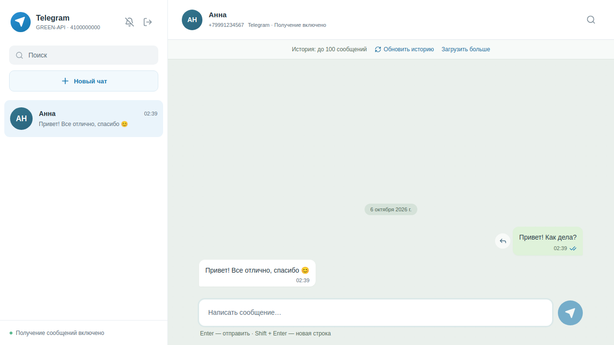
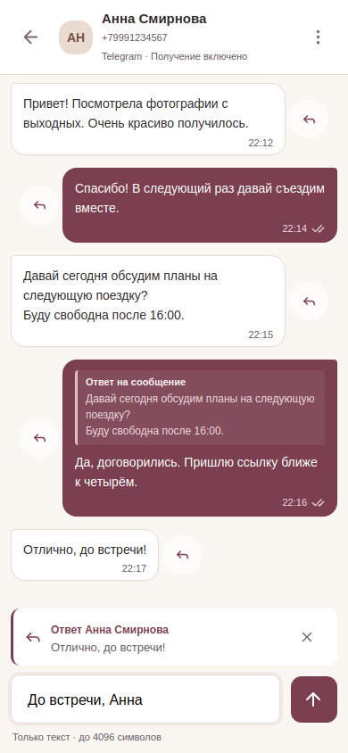

# green-api-testovoe

React-чат для текстовых сообщений через GREEN-API. Поддерживает Telegram, MAX и WhatsApp; Telegram выбран по умолчанию. Проект выполнен по тестовому заданию «Фронтенд разработчик React».

## Запуск

Нужны Node.js 22.12+ и npm.

```bash
npm ci
npm run dev
```

Приложение откроется на <http://127.0.0.1:5173>. Учетные данные вводятся в интерфейсе, `.env` не требуется.

## Подключение GREEN-API

1. Создайте инстанс нужного мессенджера в [личном кабинете](https://console.green-api.com/) и авторизуйте аккаунт. Для Telegram нужен пользовательский аккаунт, а не токен бота.
2. Выберите мессенджер и введите `idInstance` и `apiTokenInstance`. Адрес API определяется по ID; при необходимости укажите `apiUrl` из кабинета в поле «Адрес сервера API».
3. В настройках инстанса включите `incomingWebhook: yes` и оставьте Webhook URL пустым. Для статусов доставки нужен `outgoingWebhook: yes`; для сообщений, отправленных с телефона и через API, — `outgoingMessageWebhook` и `outgoingAPIMessageWebhook`.
4. Нажмите «Новый чат» и введите международный номер получателя. Отправьте текст и ответьте со второго аккаунта в мессенджере.

Используйте один HTTP-потребитель очереди на инстанс: после обработки приложение удаляет уведомления через `DeleteNotification`. Неподдерживаемые уведомления также подтверждаются, чтобы очередь продолжала работать.

| Мессенджер | Проверка номера | Адрес получателя              | Лимит текста   |
| ---------- | --------------- | ----------------------------- | -------------- |
| Telegram   | `CheckAccount`  | Числовой `chatId`             | 4096 символов  |
| MAX        | `CheckAccount`  | Числовой `chatId`             | 4000 символов  |
| WhatsApp   | `CheckWhatsapp` | `chatId` с `@lid` или `@c.us` | 20000 символов |

MAX поддерживает поиск по номерам РФ и Беларуси. Поиск в Telegram зависит от приватности аккаунта и лимитов сервиса. WhatsApp-адреса объединяются в один разговор, когда проверка номера установила связь между ними.

## Возможности

- Отправка кнопкой или Enter; Shift + Enter добавляет строку. Черновики и выбранные цитаты сохраняются при переключении чатов и ошибке отправки.
- Получение сообщений, непрочитанные счетчики и статусы доставки. Новые сообщения не сбивают позицию при чтении истории.
- История: последние 100 сообщений при открытии чата, обновление и увеличение глубины до установленного приложением предела 5000. История объединяется с текущими сообщениями по ID.
- Поиск по загруженному тексту текущего чата с подсветкой. Enter / Shift + Enter переключают результаты, Escape закрывает поиск.
- Уведомления браузера после включения колокольчиком и разрешения пользователя. Они появляются для новых входящих сообщений в фоновой вкладке; нажатие открывает чат.
- Ответы с цитированием. Кнопка рядом с сообщением выбирает цитату, крестик отменяет ответ. Нажатие на цитату переходит к загруженному оригиналу.
- Мобильная навигация и управление диалогами с клавиатуры.

## Ограничения

Токен, список чатов и черновики хранятся в памяти вкладки. После перезагрузки нужно войти и открыть чат по номеру заново; доступная история загрузится с сервера. Медиа не отображаются.

Глубина истории зависит от сервиса и настроек инстанса. [MAX возвращает до 5000 сообщений за три месяца](https://green-api.com/v3/docs/api/journals/GetChatHistory/); [история WhatsApp может появляться с задержкой до двух минут](https://green-api.com/en/docs/api/journals/GetChatHistory/). Поиск охватывает только загруженные сообщения.

Уведомления требуют HTTPS или localhost и поддержки Notifications API. Они работают, пока вкладка открыта; push при закрытой вкладке отсутствует.

Это браузерный клиент: токен виден владельцу вкладки в сетевых запросах. Он отправляется только на HTTPS-адреса `green-api.com` и не включается в сообщения об ошибках. Автоматического повтора отправки нет: после сетевой ошибки стоит проверить переписку перед повтором, чтобы избежать дубликатов. Принятие сообщения API в очередь еще не означает доставку.

## Устройство проекта

React 19, TypeScript, Vite и Lucide; состояние чатов хранится в reducer.

| Каталог          | Назначение                                                                                    |
| ---------------- | --------------------------------------------------------------------------------------------- |
| `src/api`        | HTTP-клиент и последовательный polling с подтверждением уведомлений                           |
| `src/messengers` | Контракт адаптера, проверка номеров, история, отправка и нормализация событий каждого сервиса |
| `src/chat`       | Состояние переписки, слияние сообщений и уведомления браузера                                 |
| `src/App.tsx`    | Экран подключения и интерфейс чата                                                            |
| `tests`          | Браузерные сценарии Playwright с перехватом API-запросов                                      |

Для нового мессенджера добавьте запись в `MessengerId` и `messengerInfo`, реализуйте `MessengerAdapter` и зарегистрируйте его в фабрике `createMessengerAdapter`. Адаптер возвращает события `ChatEvent` и известные альтернативные адреса получателя. Проверки контракта находятся рядом с адаптерами.

## Проверки

```bash
npm run lint
npm run format:check
npm test
npm run build
npx playwright install chromium
npm run test:e2e
```

Vitest проверяет API-контракты, очередь, слияние истории, статусы, цитаты и уведомления. Playwright проверяет сценарии отправки и ответа для всех мессенджеров, ошибки, поиск, прокрутку и мобильный интерфейс. API в тестах заменен моками; реальную доставку нужно проверить с учетными данными и двумя аккаунтами.

`npm run format` запускает Prettier, `npm run lint:fix` — ESLint с исправлениями. Перед коммитом Husky и lint-staged форматируют staged-файлы и проверяют JS/TS через ESLint. При ошибке коммит блокируется. Hook устанавливается при `npm ci` внутри Git-репозитория.

## Размещение

```bash
npm run build
npm run preview
```

Публикуйте содержимое `dist` на HTTPS-хостинге статических сайтов. Для размещения в российском сегменте подойдет [Timeweb Cloud App Platform](https://timeweb.cloud/docs/apps/deploying-frontend-apps/static-website): режим HTML/CSS/JS принимает уже собранные файлы. Учетные данные GREEN-API вводятся пользователем, их не нужно добавлять в настройки сборки.

## Документация GREEN-API

| Сервис   | Отправка                                                                    | Проверка номера                                                               | Получение                                                                                              |
| -------- | --------------------------------------------------------------------------- | ----------------------------------------------------------------------------- | ------------------------------------------------------------------------------------------------------ |
| Telegram | [SendMessage](https://green-api.com/telegram/docs/api/sending/SendMessage/) | [CheckAccount](https://green-api.com/telegram/docs/api/service/CheckAccount/) | [HTTP API](https://green-api.com/telegram/docs/api/receiving/technology-http-api/ReceiveNotification/) |
| MAX      | [SendMessage](https://green-api.com/v3/docs/api/sending/SendMessage/)       | [CheckAccount](https://green-api.com/v3/docs/api/service/CheckAccount/)       | [HTTP API](https://green-api.com/v3/docs/api/receiving/technology-http-api/)                           |
| WhatsApp | [SendMessage](https://green-api.com/docs/api/sending/SendMessage/)          | [CheckWhatsapp](https://green-api.com/docs/api/service/CheckWhatsapp/)        | [HTTP API](https://green-api.com/docs/api/receiving/technology-http-api/)                              |

## Скриншоты

Скриншоты используют тестовые данные.





Остальные примеры: [MAX](docs/screenshots/max-chat.png), [WhatsApp](docs/screenshots/whatsapp-chat.png), [ответ с цитатой](docs/screenshots/telegram-features.png), [цитирование на телефоне](docs/screenshots/mobile-features.png).

## Статус задания

Реализованы ввод учетных данных, создание чата по номеру, отправка через `SendMessage`, получение и подтверждение HTTP-уведомлений. Telegram используется как разрешенная альтернатива MAX. Добавлены история, поиск, уведомления и цитирование.

Перед сдачей остаются проверка реальной доставки, публикация репозитория и, при необходимости, размещение приложения. К письму нужно приложить резюме с Telegram для связи, ссылки на репозиторий и инструкцию запуска, указать предпочтительный формат работы. Тема: «Тестовое задание на должность - Фронтенд разработчик React».
